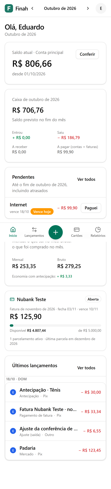
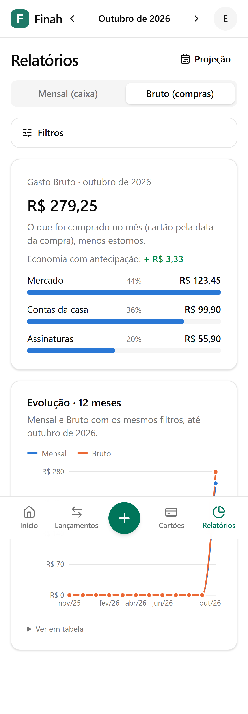
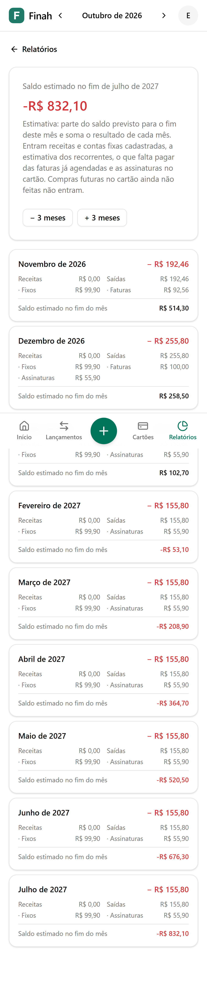

<div align="center">


# Finah

**Controle financeiro do casal, sem errar um centavo.**

Uma conta principal compartilhada, cartões de crédito com fatura de verdade, importação do extrato do banco,
relatórios que fecham e um bot no Telegram para lançar um gasto em uma linha.
Self-hosted, feito para duas pessoas, pensado para o celular.

[](https://github.com/EduCintraBR/finahapp/actions/workflows/deploy.yml)

</div>

<table>
  <tr>
    <td align="center"><br /><sub><b>Início</b>: saldo, caixa do mês, pendentes e cartões</sub></td>
    <td align="center"><br /><sub><b>Relatórios</b>: por categoria e evolução de 12 meses</sub></td>
    <td align="center"><br /><sub><b>Projeção</b>: o que vem pela frente, mês a mês</sub></td>
  </tr>
</table>

## Por que o Finah existe

Planilhas e apps genéricos erram nos detalhes que importam para uma família: a compra parcelada que cai em três
faturas, o estorno que reduz o gasto do mês certo, o pagamento de fatura que não é "gasto". O Finah foi feito em torno
de **precisão contábil**: o que o app mostra bate com o extrato do banco, centavo a centavo.

- **Dois usuários, uma conta.** Cada lançamento sabe quem lançou e de quem é o gasto (de um dos dois, ou do casal).
- **Rápido no celular.** Lançar um gasto leva 2 toques; dar baixa numa conta, também. Instala na tela inicial (PWA).
- **Seu, no seu servidor.** Sem assinatura e sem entregar seus dados a terceiros. Um `docker compose up` e pronto.

## O que ele faz

### Conta principal

- Despesas e receitas à vista, com categoria, meio de pagamento (Pix, débito, boleto…) e de quem é.
- **Fixos e recorrentes**: aluguel, internet, salário. O app cria a conta do mês como pendente no dia do vencimento;
  você dá a baixa com o valor real em 2 toques. Reajuste "a partir de um mês" e encerramento sem mexer no passado.
- **Conferência de saldo**: informe o que o banco mostra; se não bater, o app mostra a diferença e lança o ajuste exato.
- Nada é apagado de verdade: tudo fica no histórico de auditoria, com quem fez e quando.

### Cartões de crédito

- Cada compra cai na **fatura certa** pela data de fechamento real (editável quando o banco muda). Depois de lançar, a tela volta para a fatura onde a compra caiu, com os itens separados por dia.
- **Parcelamento** com a soma sempre exata: o resto do arredondamento vai na primeira parcela.
- **Limite disponível** derivado das faturas, **pagar fatura** (total ou parcial) e desfazer o pagamento.
- **Antecipação de parcelas** com o desconto que o banco deu contado como economia.
- **Estorno** (parcial ou compra inteira) que abate o gasto do mês em que aconteceu.
- Parcelamentos em andamento de antes do Finah, assinaturas no cartão e cartão adicional de outra pessoa.

### Importação do extrato e da fatura (OFX)

- Importe o **OFX ou o CSV do Nubank** (conta e cartão): cada linha é comparada com o que já está lançado.
- Sugestões de conciliação por valor e data, **sem nunca duplicar**; contas pendentes recebem a baixa automaticamente.
- RDB e Pix entre as contas do casal viram **transferência** (mexem no saldo, mas não são gasto nem receita).
- Conferência no final: o saldo do app tem que bater com o do arquivo.
- **Meses anteriores ao início do controle**: o app recua o saldo inicial calculando-o do próprio arquivo, e só segue se ele bater com o saldo atual.
- Na revisão: troque o match por outro lançamento, ignore linhas em lote (útil na fatura do cartão adicional) e atualize as sugestões.

### Painel inicial

- Saldo em destaque com a **previsão do fim do mês**, indicadores do mês, **pizza dos gastos por categoria**, saídas dos últimos 6 meses, cartões, pendências (dar baixa em 2 toques) e últimos lançamentos.
- **Navegue pelos meses**: ao voltar um mês, tudo muda junto, inclusive a fatura de cada cartão (ou "nenhuma fatura lançada para esse mês").
- **Tema escuro (padrão) ou claro**, por aparelho.

### Relatórios e projeção

- **Gasto Mensal** (o que sai da conta no mês, com as faturas que vencem nele) e **Gasto Bruto** (o que foi comprado no mês).
- Gasto por categoria com filtros por pessoa, cartão e meio de pagamento; evolução dos últimos 12 meses.
- **Projeção** dos próximos meses com receitas e contas cadastradas, faturas já agendadas e assinaturas.

### Categorias

- Crie, renomeie e arquive categorias; ajuste os **apelidos** que o bot e a importação usam para reconhecê-las.

### Bot do Telegram

- Mande `mercado 180 no pix`, `tênis 600 no nubank em 3x` ou `recebi 5000 de salário`: o bot entende (via Claude Haiku, leve e barato), lança e mostra o saldo.
- Quando não tem certeza, mostra o que entendeu e pede confirmação. `/desfazer` volta atrás, e **✏️ Corrigir** troca a categoria ou de quem é o gasto, antes ou depois de lançar.
- **Pergunte** com as suas palavras: limite dos cartões, contas pendentes do mês, resumo de fatura, gastos por categoria, resumo do mês, últimos lançamentos. Sem mês dito vale o mês atual; aceita "novembro", "mês que vem", "mês passado". Também por comando (`/limite`, `/pendentes novembro`, `/fatura nubank`, `/gastos`, `/resumo`, `/ultimos`).
- Lança **receitas** e despesas ("recebi 5000 de salário"). Todo dia às 9h chega o lembrete do que vence.
- Só responde aos dois usuários cadastrados; o contexto enviado ao modelo nunca inclui saldos.

## Princípios (as regras que não se quebram)

1. **Dinheiro é inteiro, em centavos.** Nada de `float` em lugar nenhum.
2. **Datas de negócio são `YYYY-MM-DD`.** Sem fuso horário escondido mudando o dia da compra.
3. **Saldo, limite e total de fatura nunca são armazenados**: são sempre calculados a partir dos lançamentos.
4. **Pagamento de fatura não é gasto**, para nunca contar a mesma despesa duas vezes.
5. **Nada é apagado**: lançamentos são marcados, e toda mudança grava auditoria.
6. **Toda escrita em várias tabelas é uma transação.** Ou entra tudo, ou nada.

As regras completas, com as decisões tomadas, estão em [docs/SPEC.md](docs/SPEC.md).

## Segurança

Dados financeiros de duas pessoas, na internet: o Finah é fechado por padrão.

- **Login com 2FA obrigatório** (senha + app autenticador, com códigos de recuperação de uso único), senhas com argon2id e limite de tentativas.
- Sessões que caem ao trocar a senha ou com **"sair de todos os aparelhos"**.
- **CSP com nonce**, HSTS e cabeçalhos de segurança; nenhum script de terceiros.
- Segredos do 2FA cifrados no banco; **backups off-site cifrados** (age) com a chave só com o dono.
- VPS com SSH só por chave, fail2ban, atualizações automáticas e firewall; containers sem privilégios.
- Repositório com `main` protegida, actions fixadas por SHA, Dependabot e secret scanning.

## Tecnologia

| Camada    | O que usamos                                                                                   |
| --------- | ---------------------------------------------------------------------------------------------- |
| App       | Next.js 16 (App Router) + TypeScript `strict`, Tailwind CSS, shadcn/ui, Recharts               |
| Dados     | PostgreSQL 16 com Drizzle ORM e migrações versionadas                                          |
| Auth      | Auth.js (e-mail e senha com argon2id, sessão JWT)                                              |
| Validação | Zod em tudo que entra (formulários, ações, bot, linhas importadas)                             |
| Jobs      | pg-boss num container `worker` (ocorrências de fixos, lembretes, bot em polling)               |
| Bot       | grammY + Claude (Anthropic SDK com saída estruturada)                                          |
| Testes    | Vitest, fast-check (property tests do dinheiro), PGlite (Postgres real nos testes), Playwright |
| Infra     | Docker Compose, nginx + Let's Encrypt, backup diário com cópia no Google Drive (rclone)        |

## Rodando localmente

Precisa de Node 24+, pnpm (`corepack enable`) e Docker.

```bash
cp .env.example .env        # preencha as senhas, o AUTH_SECRET e os usuários do seed
docker compose up -d db     # só o Postgres
pnpm install
pnpm db:migrate && pnpm db:seed
pnpm dev                    # http://localhost:3000
```

Ou a stack completa (app, worker, banco e backup): `docker compose up -d --build`.
O guia completo, com bot, produção e backup, está em [docs/GUIA.md](docs/GUIA.md).

## Qualidade

```bash
pnpm typecheck && pnpm lint && pnpm test && pnpm test:acceptance && pnpm test:e2e
```

| Suíte                              | O que cobre                                                                                            |
| ---------------------------------- | ------------------------------------------------------------------------------------------------------ |
| Unidade (`pnpm test`)              | Regras de domínio puras: dinheiro, datas, faturas, projeção, conciliação, categorias                   |
| Aceitação (`pnpm test:acceptance`) | Cenários de ponta a ponta contra Postgres de verdade (PGlite), incluindo as fórmulas de saldo e fatura |
| E2E (`pnpm test:e2e`)              | O app no navegador em 375px (celular), do login ao fechamento do mês                                   |

## Fluxo de trabalho e deploy (CI/CD)

```
feature ──► dev ──► Pull Request ──► main ──► produção (finahapp.com)
             │                           │
             └─ CI ─► deploy dev         └─ CI completo ─► deploy automático
                (dev.finahapp.com)
```

- **`main` é produção.** Todo push na `main` (normalmente o merge de um Pull Request da `dev`) roda o CI completo e, **só se tudo passar**, o GitHub Actions publica na VPS.
- **`dev` é onde o trabalho acontece e tem o seu ambiente**: todo push na `dev` (merge de PR ou commit direto) roda o CI e, se passar, publica em **https://dev.finahapp.com** (mesma VPS, stack e banco próprios, com uma cópia dos dados da produção e o bot desligado). Pull Requests rodam o CI, sem publicar.
- **A `main` é protegida**: só entra por Pull Request, com o CI verde (typecheck/lint/testes, E2E e compose do zero); não aceita push direto nem force push.
- O deploy faz **backup do banco**, envia o código, sobe a nova versão (as migrações rodam antes do app), confere se o app respondeu e **volta para a versão anterior** se algo falhar.
- Detalhes em [`deploy.yml`](.github/workflows/deploy.yml) (produção), [`deploy-dev.yml`](.github/workflows/deploy-dev.yml) (dev) e [`ci.yml`](.github/workflows/ci.yml).

## Documentação

- [docs/SPEC.md](docs/SPEC.md): regras de negócio e o registro de decisões
- [docs/ROADMAP.md](docs/ROADMAP.md): fases, o que está pronto e os critérios
- [docs/GUIA.md](docs/GUIA.md): guia de uso, bot, produção e backup
- [CLAUDE.md](CLAUDE.md): convenções de código e invariantes do projeto

## Status

Em produção desde outubro de 2026. Fases 1 a 4 concluídas (fundação, conta, cartões, relatórios), mais a importação
de extrato e fatura do Nubank e o bot do Telegram. Próximos passos no [roadmap](docs/ROADMAP.md).

Projeto pessoal, ainda sem licença definida.
